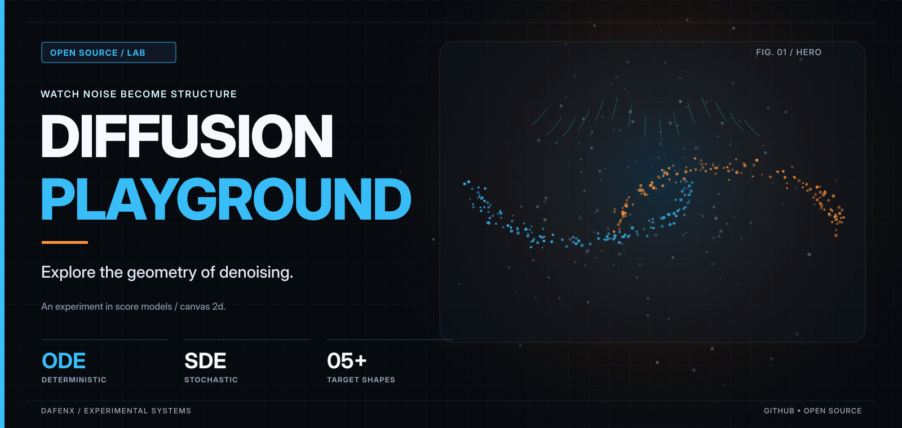
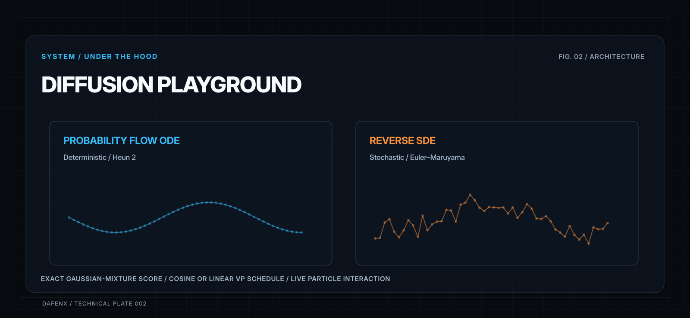

<p align="center">
  
</p>

<p align="center">
  <a href="https://github.com/Dafenxz0/diffusion-playground/actions/workflows/ci.yml"></a>
  <a href="https://dafenxz0.github.io/diffusion-playground/"></a>
</p>

# Diffusion Playground

### Turn a cloud of noise into a shape, one step at a time.

An interactive 2D laboratory for **score-based diffusion**. Compare deterministic **Probability Flow ODE** sampling with stochastic **reverse SDE** paths, draw your own target distribution and perturb particles while the denoising process is running.

<p align="center"><a href="https://dafenxz0.github.io/diffusion-playground/"><strong>EXPLORE THE LIVE DEMO</strong></a></p>



## What makes this playground different?

The score field is evaluated **analytically from a Gaussian mixture over the chosen 2D target samples**. This is **not** a pretrained image diffusion model or a neural network estimating the score. You can see the exact score vectors as time evolves.

| Experiment | What you see |
| --- | --- |
| **ODE / Flow** | Deterministic trajectories integrated with second-order Heun |
| **SDE** | Reverse stochastic trajectories integrated with Euler–Maruyama noise |
| **Shapes** | Spiral, Two Moons, Heart, Star, Rings or your own drawing |
| **Perturbation** | Scatter or grab particles during denoising |
| **Telemetry** | Noise time, `α`, `σ`, SNR, score norm and manifold distance |

## Open it

**[Launch Diffusion Playground →](https://dafenxz0.github.io/diffusion-playground/)**

Use the mouse to sketch a custom target or to perturb particles, choose ODE or SDE and scrub the diffusion clock `t ∈ [0,1]`.

| Control | Action |
| --- | --- |
| Left-drag | Draw / Scatter / Grab, depending on active tool |
| `Space` | Play / pause |
| `R` | Reset particles |
| `t` scrubber | Move forward/backward in noise time |
| `Hold t` | Fixed-time score-flow or Langevin relaxation |

## The math, compactly

For a noised target set $\{y_i\}_{i=1}^M$, the VP schedule yields $\alpha_t^2+\sigma_t^2=1$. The marginal is a Gaussian mixture with variance $v_t=\sigma_t^2+\alpha_t^2\sigma_{\mathrm{data}}^2$.

The implemented exact empirical score is

$$
\nabla_x\log p_t(x)=\frac{\alpha_t\sum_{i=1}^{M} w_i(x,t)y_i-x}{v_t},
\qquad w_i\propto\exp\left(-\frac{\lVert x-\alpha_t y_i\rVert^2}{2v_t}\right).
$$

From that field, the two samplers integrate different dynamics:

$$
\text{ODE: }\frac{dx}{dt}=-\tfrac12\beta(t)[x+\nabla_x\log p_t(x)]
$$

$$
\text{SDE: }dx=[-\tfrac12\beta(t)x-\beta(t)\nabla_x\log p_t(x)]dt+\sqrt{\beta(t)}\,d\bar w.
$$

[`src/diffusion.js`](src/diffusion.js) contains the schedule, analytic score and integrators; [`src/shapes.js`](src/shapes.js) generates target samples; [`src/renderer.js`](src/renderer.js) draws particles and vectors, and [`src/main.js`](src/main.js) wires up interaction.

## Local start

The project uses native browser ES modules and Canvas 2D, so no bundler is needed:

```bash
git clone https://github.com/Dafenxz0/diffusion-playground.git
cd diffusion-playground
node --test tests/diffusion.test.js
python3 -m http.server 8000
```

Open `http://localhost:8000`. A Node.js 20+ runtime is recommended for the tests.

**Interpretation note:** the diagram is schematic. ODE and SDE share target marginals in the ideal continuous-time formulation, but individual trajectories differ, especially under finite-step numerical integration.

## License

MIT. See [`LICENSE`](LICENSE).
